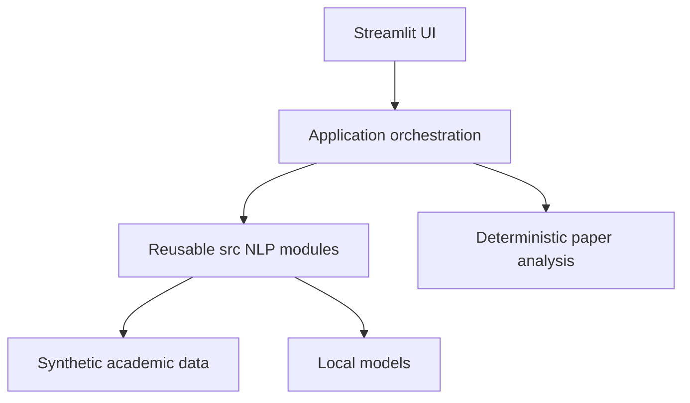
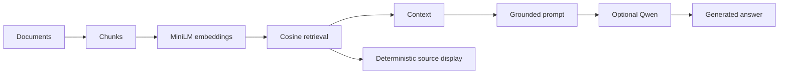

# NLP-Based Intelligent Academic Assistant

**From Classical NLP to Transformers and Retrieval-Augmented Generation**

A **2-Day Hands-On NLP Workshop for Engineering Students**, themed **From Classical NLP to Generative AI: Building an Intelligent Academic Assistant**.

## Project overview

Students progressively implement the NLP components that support document understanding, semantic retrieval and grounded generation, then integrate them into an academic assistant. The learning labs expose inputs, intermediate representations, calculations, scores and results.

This is the complete **instructor/reference** repository. Its 49 algorithm TODO IDs identify 50 small core regions; TODO1.7 has separate vocabulary and frequency parts. A deterministic builder generates the student starter from these markers. Students implement NLP concepts; starter code provides UI, model/resource setup, caching, validation and deployment infrastructure.

## What students build

```text
Raw Text → Preprocessing → BoW / N-Grams → TF-IDF → Cosine Search
→ Word2Vec → Sentence Embeddings → Semantic Search → Attention
→ Transformers → Chunking → Semantic Retrieval → Grounded Prompt
→ RAG → Question Paper Analyzer → Academic Assistant
```

**UNDERSTAND → IMPLEMENT → EXPERIMENT → COMPARE → INTEGRATE → DEPLOY**

**Words → Numbers → Meaning → Retrieval → Context → Generation → Intelligent Application**

## Features

| Component | Educational purpose |
|---|---|
| Interactive NLP Learning Lab | Visible transformations and reusable notebook/test/UI implementations |
| Classical NLP | Manual preprocessing, numerical representations, TF-IDF and cosine search; library comparisons afterward |
| Word Embeddings | Tiny local Word2Vec, CBOW/Skip-Gram, geometry and PCA; GloVe/FastText concepts |
| Semantic Search | Shared sentence encoder and explicit cosine/Top-K comparison with lexical retrieval |
| Transformer NLP | Manual attention plus pretrained CPU sentiment, NER and extractive QA |
| Transparent RAG | Inspect chunks, scores, evidence, context, grounded prompt, optional generation and source provenance |
| Question Paper Analyzer | Deterministic topic aliases, primary-topic frequencies and historical question filtering |
| Intelligent Academic Assistant | Explainable routing across academic/course navigation, papers and grounded study support |

All ten pages are **COMPLETE** in reference mode. Generated starter pages intentionally stop with TODO guidance until their prerequisite cores are implemented.

## Architecture





`src/` never imports Streamlit. One implementation powers notebooks, tests and UI. RAG source display identifies supplied evidence; it does not certify generated claims. The assistant checks course/unit-heading evidence before unit-specific generation without changing semantic scores or ranking.

### Why no LangChain?

Explicit RAG lets students inspect chunking, embeddings, cosine, Top-K, context, prompt and output directly. This is a teaching choice, rather than a judgment about orchestration libraries.

## Technology and local model inventory

Actual stack: Python, Streamlit, NLTK, scikit-learn, Gensim, Sentence Transformers, Hugging Face Transformers, PyTorch, pypdf, NumPy/Pandas and pytest. NumPy/Pandas and model infrastructure are supplied by the existing dependency graph. No database, paid API, hosted inference, Docker or separate frontend is required.

| Purpose | Pinned public model | Observed storage / licensing |
|---|---|---|
| Sentence similarity/search/chunk retrieval | sentence-transformers/all-MiniLM-L6-v2 | Compact384-dimensional CPU encoder; ~92MB snapshot (~87MiB); Apache-2.0 |
| Sentiment | distilbert/distilbert-base-uncased-finetuned-sst-2-english | ~268MB checkpoint; Apache-2.0 |
| NER | dslim/distilbert-NER | ~262MB checkpoint; Apache-2.0 |
| Extractive QA | distilbert/distilbert-base-uncased-distilled-squad | ~266MB checkpoint; Apache-2.0 |
| Optional grounded generation | Qwen/Qwen2.5-0.5B-Instruct | ~1GB cache; historical whole-process RAM ~2.12GB; Apache-2.0 |

Exact revision IDs live in `src/sentence_resources.py`, `src/transformer_resources.py` and `src/llm_resources.py`. Review upstream library/model licenses before redistribution or deployment. Storage/RAM/timing observations vary by machine; loading multiple models increases memory. Word2Vec trains locally from the supplied corpus; no large pretrained word vectors are downloaded.

## Dataset

**Hindu College of Engineering is completely fictional.** All policies, curricula, faculty and dates are original synthetic educational content, grounded in `data/university_facts.json`.

**Synthetic educational data created for NLP workshop purposes.**

The supplied knowledge environment contains 14 academic Markdown documents, four synthetic NLP papers (48 top-level questions), 20 representative course descriptions, small examples and three derived teaching PDFs. Markdown is canonical; PDFs support extraction exercises. Question metadata/benchmark expectations are evaluation artifacts, never application answers.

## Quick start

After cloning or unpacking the owner's repository, enter its root. No GitHub URL is invented here.

Recommended: **64-bit Python 3.11**. Python 3.12 is also execution-tested.

Windows PowerShell:

```powershell
py -3.11 -m venv .venv
.\.venv\Scripts\Activate.ps1
python -m pip install -r requirements.txt
```

macOS/Linux:

```sh
python3.11 -m venv .venv
source .venv/bin/activate
python -m pip install -r requirements.txt
```

Explicitly preload before class while online:

```text
python -m src.nltk_resources --download
python -m src.sentence_resources --download
python -m src.transformer_resources --download
```

Optional instructor/capable-machine generation:

```text
python -m src.llm_resources --download
```

Normal app execution uses local resources and never downloads automatically. Public checkpoints need no paid credentials or Hugging Face token.

## Preflight and run

```text
python -m workshop.preflight
python -m workshop.preflight --full-classroom --smoke
python -m streamlit run app.py
```

PASS checks an installed inventory item; WARNING marks a partial-mode missing learning cache; OPTIONAL applies to Qwen; FAIL requires setup/data repair. Inventory alone does not prove loadability; smoke checks local inference. Missing Qwen leaves retrieval/context/papers usable. Missing MiniLM leaves deterministic paper analysis usable. See [Setup Checklist](workshop/SETUP_CHECKLIST.md).

## Tests and validation

```text
python -m pytest
python -m pytest tests/test_preprocessing.py
python -m workshop.run_reliability_audit --pages
```

The Task17 baseline was551 passing tests on Python 3.11.17 and3.12.14, zero skips in prepared environments, plus63 offline audit checks. Task18 final reference suite: **574 passed** on both Python versions, zero skips; **23 packaging tests** added. Final measured details appear in [Release Validation](workshop/RELEASE_VALIDATION.md). Algorithm correctness tests in an uncompleted student starter intentionally fail; its setup smoke test is separate.

## Workshop structure

| Day | Journey | End milestone |
|---|---|---|
|1|Words → Numbers → Search → Embeddings → Meaning|Semantic search engine |
|2|Transformers → Documents → Retrieval → RAG → Analysis → Assistant|Integrated assistant and portfolio/deployment plan |

See [two-day schedule](workshop/WORKSHOP_SCHEDULE.md), [Student Guide](docs/STUDENT_GUIDE.md), [Instructor Guide](docs/INSTRUCTOR_GUIDE.md) and [Instructor Start](workshop/INSTRUCTOR_START.md). Resources are preloaded; Qwen demos are optional, not the critical path.

## Repository structure

```text
app.py       Home / multipage entrypoint
pages/       Ten educational/integration surfaces
src/         Shared NLP logic and small resource/orchestration helpers
data/        Canonical fictional facts, Markdown, corpus, papers and PDFs
notebooks/   Eight explorations importing src
docs/        Student/instructor, portfolio, deployment and limitations guides
workshop/    Setup, TODO registry, schedule, evaluators and release tooling
tests/       Reference correctness, integration, reliability and packaging tests
assets/      Optional architecture/screenshot material
```

## Student starter vs reference

Reference source stays complete and canonical. Generate, rather than hand-maintain, a second copy:

```text
python -m workshop.build_student_starter
python -m workshop.validate_student_starter dist/nlp-academic-assistant-student
python -m workshop.validate_student_starter dist/nlp-academic-assistant-student --runtime --resource-root .
```

The last command explicitly uses the instructor's preloaded resources for validation only; no caches or absolute paths enter the student bundle. `START_HERE.md` explains the generated starter. Instructor solutions, evaluators, measured reports and release tooling are excluded. Rebuilding refuses to overwrite changed student work. See [release validation matrix](workshop/RELEASE_VALIDATION.md).

## Known limitations

Semantic retrieval can miss relevant evidence, especially short/structural queries. Top-K returns nearest chunks even when the corpus has no answer. Unit-heading presence is necessary but not full entailment; the assistant conservatively withholds some generation. Small Qwen reasoning and source-label emission are imperfect. Supplied sources are not verified citations. The deterministic analyzer leaves nine implicit questions unmatched; frequency is not prediction. PDFs must contain text; no OCR. No production security/scalability claims. Browser width 1280px was verified; narrower widths remain unverified. See [Known Limitations](docs/KNOWN_LIMITATIONS.md).

## Educational outcomes and portfolio

Explain sparse/dense vectors, lexical/semantic search, word/sentence embeddings, attention, chunking, retrieval, RAG grounding and failures, deterministic NLP choices and application integration. After completing TODOs, use your own screenshots, describe your implementation and one meaningful experiment/failure, and credit the workshop context. [Portfolio Guide](docs/GITHUB_PORTFOLIO_GUIDE.md) provides templates without invented metrics.

## Deployment and release status

[Deployment Guide](docs/DEPLOYMENT_GUIDE.md) distinguishes a resource-limited Community Cloud demonstration from the local full workshop. Deployment configuration is validated locally; **live cloud deployment has not been performed**. Qwen is not required/recommended for lightweight cloud use. Community Cloud setup follows the [official deployment instructions](https://docs.streamlit.io/deploy/streamlit-community-cloud/deploy-your-app/deploy).

**Functional architecture frozen after Task17. Task18 changes are limited to packaging, documentation, validation and deployment preparation.**

Future owner-selected release/tag recommendation: `v1.0-workshop`. No remote repository, push, tag, public release or deployment is performed by these tools. **Repository license remains unselected**; the owner must select it before licensed distribution. No license was silently assigned.
